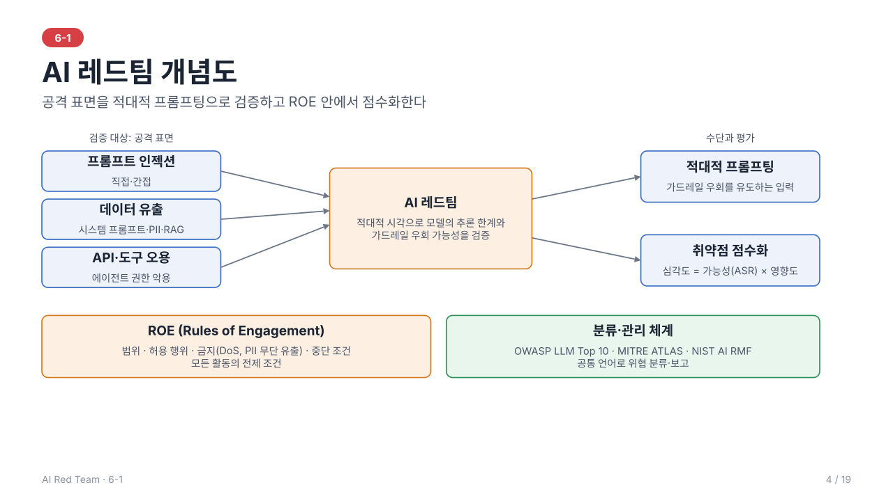
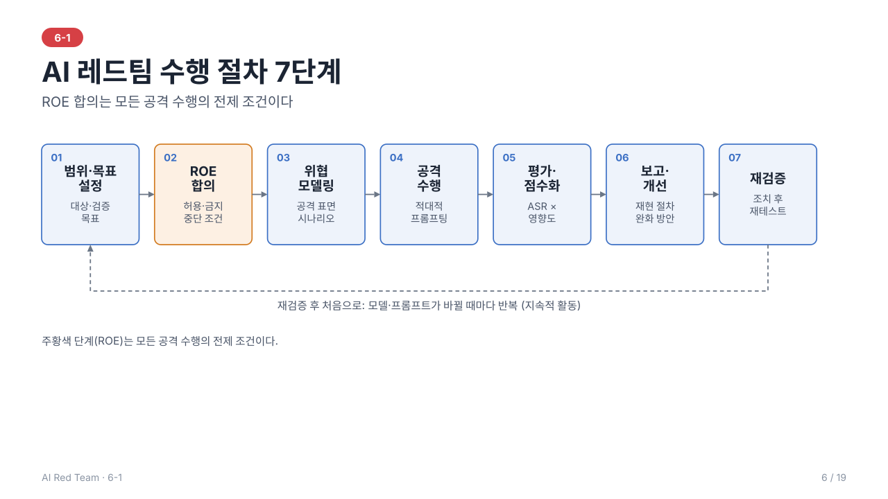

# 6-1. AI 레드팀 개념과 방법론 — 이론 정리

> 학습 목표: AI 레드팀의 개념과 절차를 이해한다.
> 주도 학습 주제: AI 레드팀 범위·규칙(ROE) 및 방법론 요약 작성

> 전체 내용을 슬라이드 19장으로도 볼 수 있다: [slides/](slides/index.html) (s1~s19)
---



## 1. AI 레드팀이란

**AI Red Teaming**은 AI 모델과 애플리케이션의 취약점을 찾기 위해 공격자의 관점에서 **적대적 공격을 수행하는 검증 기법**이다.

- 전통적인 규칙 기반·기능 테스트는 "정해진 입력에 정해진 출력이 나오는가"를 확인한다.
- AI 레드팀은 한 걸음 더 나아가 **모델의 추론 한계**와 **가드레일 우회 가능성**을 평가한다.
- 목적은 공격 성공 자체가 아니라, 실제 공격자보다 먼저 약점을 발견해 **방어를 개선**하는 것이다.

### 전통 보안 테스트와의 차이

| 구분 | 전통 보안 테스트 | AI 레드팀 |
| --- | --- | --- |
| 대상 | 코드, 네트워크, 인프라 | 모델, 프롬프트, 데이터, 연동 시스템 |
| 입력 | 정형화된 페이로드 | 자연어 등 비정형·확률적 입력 |
| 결과 | 대체로 결정적(재현 용이) | 비결정적(같은 입력도 결과가 달라질 수 있음) |
| 취약점 | 구현 결함 | 구현 결함 + 모델 행동 결함(유해 출력, 편향, 환각 등) |

---

## 2. 핵심 개념

### 2.1 Attack Surface (공격 표면)
AI 서비스에서 공격이 발생할 수 있는 노출면. 대표적으로 다음을 포함한다.

- **프롬프트 인젝션**: 사용자 입력 또는 외부 문서로 시스템 지시를 덮어쓰기
- **데이터 유출**: 학습 데이터, 시스템 프롬프트, 개인정보(PII) 노출
- **API 오용**: 도구·플러그인·에이전트 권한의 악용

### 2.2 Adversarial Prompting (적대적 프롬프팅)
모델의 가드레일을 우회하도록 **의도적으로 설계한 입력**. 역할극, 인코딩·난독화, 다단계 유도 등이 대표적인 형태다.

### 2.3 Vulnerability Scoring (취약점 점수화)
발견된 취약점의 **심각도**와 **비즈니스 영향도**를 정량 평가하여 대응 우선순위를 정하는 체계. 평가 시 고려 요소는 다음과 같다.

- 악용 용이성(공격 난이도, 필요 권한)
- 재현 가능성(비결정적 특성 때문에 성공률로 표현)
- 영향 범위(기밀성·무결성·가용성, 사용자 피해, 법·평판 리스크)

### 2.4 Rules of Engagement (ROE)
레드팀 수행 시 **허용되는 목표, 공격 수단, 제약사항**을 규정한 약속. 검증이 실제 서비스에 피해를 주지 않도록 하는 안전장치이다.

---

## 3. 방법론

AI 레드팀은 일반적으로 아래 절차로 진행한다.

```
① 범위·목표 설정 → ② ROE 합의 → ③ 위협 모델링 → ④ 공격 수행 → ⑤ 평가·점수화 → ⑥ 보고·개선 → ⑦ 재검증
```



| 단계 | 내용 |
| --- | --- |
| ① 범위·목표 설정 | 대상 시스템(모델/앱/에이전트)과 검증 목표(유해 출력, 정보 유출 등)를 정의 |
| ② ROE 합의 | 허용·금지 행위와 중단 조건을 문서화하고 승인 |
| ③ 위협 모델링 | 공격 표면과 공격자 유형을 식별해 시나리오 도출 |
| ④ 공격 수행 | 적대적 프롬프팅 등 시나리오 실행, 모든 시도와 결과를 기록 |
| ⑤ 평가·점수화 | 성공률·영향도 기반으로 취약점 심각도 산정 |
| ⑥ 보고·개선 | 재현 절차와 완화 방안(가드레일 강화, 권한 최소화 등)을 보고 |
| ⑦ 재검증 | 조치 후 동일 시나리오로 재테스트하여 개선을 확인 |

> 모델은 업데이트되면 행동이 바뀌므로 레드팀은 **일회성이 아니라 반복적·지속적** 활동이어야 한다.

---

## 4. ROE 구성 요소

| 항목 | 예시 |
| --- | --- |
| 범위(Scope) | 테스트 대상 모델·API·환경(운영/스테이징) |
| 허용 행위 | 프롬프트 인젝션, 탈옥 시도, 정보 추출 시도 |
| 금지 행위 | **서비스 중단(DoS) 유발 금지**, **PII 무단 유출·보관 금지**, 범위 외 시스템 공격 금지 |
| 데이터 취급 | 획득한 민감 정보의 최소 수집, 보관·폐기 규칙 |
| 중단 조건 | 의도치 않은 장애·실제 피해 징후 발생 시 즉시 중단 및 통보 |
| 보고 체계 | 연락 창구, 취약점 공유 시점과 방식 |

핵심 원칙은 **"시스템의 안전한 운영을 해치지 않는 범위에서 검증한다"**는 것이다.

---

## 5. 위협 분류 체계와 프레임워크

레드팀 시나리오를 설계하고 결과를 공통 언어로 보고하기 위해 표준 분류 체계를 활용한다.

### 5.1 OWASP Top 10 for LLM Applications (2025)

| ID | 위험 | 핵심 내용 |
| --- | --- | --- |
| LLM01 | Prompt Injection | 입력(직접/간접)으로 모델 지시·행동을 조작 |
| LLM02 | Sensitive Information Disclosure | 민감 정보·PII·기밀이 출력에 노출 |
| LLM03 | Supply Chain | 외부 모델·데이터·라이브러리의 오염 |
| LLM04 | Data and Model Poisoning | 학습·미세조정·임베딩 데이터 오염 |
| LLM05 | Improper Output Handling | 모델 출력을 검증 없이 후속 시스템에 전달 |
| LLM06 | Excessive Agency | 모델/에이전트에 과도한 기능·권한 부여 |
| LLM07 | System Prompt Leakage | 시스템 프롬프트 내 민감 정보·로직 노출 |
| LLM08 | Vector and Embedding Weaknesses | RAG·벡터 저장소의 취약점 |
| LLM09 | Misinformation | 환각 등 잘못된 정보 생성과 과신 |
| LLM10 | Unbounded Consumption | 과도한 자원 사용(기존 DoS 확장, 비용 폭증 포함) |

### 5.2 MITRE ATLAS
AI/ML 시스템에 대한 공격자의 **전술(Tactic)과 기법(Technique)** 지식베이스로, MITRE ATT&CK 구조를 따른다. 정찰, 초기 접근, 실행, 지속성, 방어 회피, 유출, 영향 등 공격 단계별로 기법을 정리하며 실제 사례(case study)를 포함한다. 전술·기법 수는 버전마다 달라지므로 최신 내용은 공식 사이트에서 확인한다.

### 5.3 NIST AI RMF
조직 차원의 AI 위험 관리 프레임워크로 **Govern(거버넌스) · Map(식별) · Measure(측정) · Manage(관리)** 네 기능으로 구성된다. 레드팀은 주로 **Measure** 단계의 검증 활동에 해당한다.

> 사용 방식: OWASP는 "무엇이 위험한가"(위험 목록), ATLAS는 "공격이 어떻게 진행되는가"(공격 절차), NIST AI RMF는 "조직이 어떻게 관리하는가"(관리 체계)를 설명한다.

---

## 6. 공격 유형 분류

| 공격 유형 | 설명 | 대상 단계 |
| --- | --- | --- |
| **직접 프롬프트 인젝션** | 사용자가 입력에 직접 지시를 삽입해 시스템 지시를 덮어씀 | 추론 |
| **간접 프롬프트 인젝션** | 웹페이지·문서·이메일 등 외부 데이터에 숨긴 지시가 모델에 유입 | 추론(RAG·에이전트) |
| **탈옥(Jailbreak)** | 역할극·인코딩·다단계 유도로 안전 정책 자체를 우회 | 추론 |
| **데이터 포이즈닝** | 학습·미세조정 데이터에 악성 샘플을 주입해 행동 조작·백도어 생성 | 학습 |
| **회피 공격(Evasion)** | 미세한 변형(적대적 예제)으로 오분류 유도 | 추론 |
| **모델 추출(Extraction)** | 반복 질의로 모델 기능·파라미터를 복제 | 추론/API |
| **모델 인버전·멤버십 추론** | 출력으로 학습 데이터 복원, 특정 데이터의 학습 포함 여부 추론 | 추론 |
| **에이전트·도구 오용** | 연동 도구·API 권한을 악용해 의도하지 않은 행동 실행 | 추론(에이전트) |

> 탈옥은 **모델의 안전 정책** 우회이고, 프롬프트 인젝션은 **애플리케이션의 지시 체계** 탈취라는 점에서 구분된다. 실제 공격은 두 가지를 함께 쓰는 경우가 많다.

---

## 7. 레드팀의 분류

### 7.1 대상 수준에 따른 구분
- **모델 레벨**: 모델 자체의 안전성(유해 출력, 편향, 탈옥 저항성)을 평가
- **시스템 레벨**: 모델 + 프롬프트, RAG, 도구, 권한, 인프라가 결합된 서비스 전체를 평가. 실제 피해는 대개 시스템 레벨에서 발생한다.

### 7.2 수행 방식에 따른 구분
| 구분 | 장점 | 한계 |
| --- | --- | --- |
| **수동** (전문가) | 창의적·맥락 의존적 공격 발견 | 비용·시간, 확장성 낮음 |
| **자동화** (도구·모델 기반) | 대량·반복 테스트, 회귀 검증에 유리 | 새로운 유형의 공격 발견에 약함 |

두 방식을 병행하는 것이 일반적이다.

### 7.3 레드팀·블루팀·퍼플팀
- **레드팀**: 공격자 역할로 취약점 탐색
- **블루팀**: 방어·탐지·대응 담당
- **퍼플팀**: 두 팀이 결과를 공유하며 방어를 함께 개선하는 협업 형태

---

## 8. 평가 지표와 방어 원칙

### 8.1 평가 지표
- **공격 성공률(ASR, Attack Success Rate)**: 전체 시도 중 목표를 달성한 비율. 비결정적 모델의 재현성을 수치로 표현한다.
- **유해 출력 비율**: 정책 위반 응답의 비중
- **우회 난이도**: 성공에 필요한 시도 횟수, 전문성, 권한
- **영향도**: 노출된 정보의 민감도, 실행된 동작의 파급 범위

> 위험도 ≈ 가능성(성공률·난이도) × 영향도 로 종합하여 우선순위를 정한다.

### 8.2 방어 원칙 (레드팀 결과의 개선 방향)
- **심층 방어**: 단일 가드레일에 의존하지 않고 입력 필터, 시스템 프롬프트, 출력 검증, 모니터링을 다층으로 구성
- **최소 권한**: 모델·에이전트에 필요한 도구와 데이터 접근만 부여
- **신뢰 경계 분리**: 외부 데이터는 비신뢰 입력으로 취급하고 지시와 데이터를 구분
- **출력 비신뢰**: 모델 출력도 검증 후 후속 시스템에 전달
- **지속 모니터링**: 모델·프롬프트 변경 시 회귀 테스트 수행

---

## 9. 법·윤리적 고려

- 테스트는 **사전 승인**을 받은 범위 안에서만 수행한다.
- 서비스 약관과 개인정보·저작권 관련 법규를 준수한다.
- 발견한 취약점과 획득 데이터는 **책임 있는 공개(Responsible Disclosure)** 원칙에 따라 취급한다.
- 유해 콘텐츠 생성 테스트의 결과물은 불필요하게 보관·유포하지 않는다.

---

## 10. 이후 일차와의 연결

이 장은 뒤 일차가 전제로 삼는 기초 이론이다. 아래 개념은 이 장에서 정의하고, 자세한 내용은 해당 일차에서 다룬다.

| 이 장의 개념 | 쓰이는 일차 | 어떻게 쓰이는가 |
| --- | --- | --- |
| 7단계 수행 절차 (3장) | 6-2 ~ 6-7 | ②·③단계는 6-2, ④ 공격 수행은 6-3~6-5, ⑤ 평가는 6-6, ⑥·⑦ 보고·재검증은 6-7 |
| ROE (4장) | 6-3 ~ 6-5 | 모든 실습의 범위와 금지 행위 기준 (샌드박스, 더미 데이터, 호출량 제한) |
| 공격 표면 (2.1) | 6-2, 6-3, 6-4 | 시나리오의 공격 벡터 선택, 도구·데이터 유출 경로 |
| 공격 유형 분류 (6장) | 6-3, 6-4 | 탈옥·도구 오용은 6-3, 간접 인젝션·유출은 6-4에서 상세히 다룸 |
| 위협 분류 체계 (5장) | 6-2, 6-7 | 시나리오와 발견 사항을 OWASP·ATLAS 항목으로 분류 |
| 취약점 점수화·ASR (2.3, 8.1) | 6-6, 6-7 | 지표 정의와 측정(6-6), 심각도 평가(6-7) |
| 방어 원칙 (8.2) | 6-3, 6-4, 6-7 | 통제 지점 설계와 개선안 도출 |

> 6장(공격 유형), 8장(평가 지표·방어 원칙)은 개요 수준이다. 상세는 6-3·6-4(공격·방어), 6-6(지표), 6-7(개선안)에서 다룬다.

---

## 11. 요약

1. AI 레드팀 = 적대적 시각으로 AI의 추론 한계와 가드레일 우회 가능성을 검증하는 활동
2. 검증 대상은 **공격 표면**(인젝션·데이터 유출·API 오용)이며, 수단은 **적대적 프롬프팅**
3. **OWASP LLM Top 10 · MITRE ATLAS · NIST AI RMF**로 위협을 분류하고 공통 언어로 보고
4. 공격은 추론·학습 단계 전반에 걸치며(인젝션, 탈옥, 포이즈닝, 추출 등), 실제 위험은 **시스템 레벨**에서 커진다
5. 결과는 **ASR·영향도** 기반 **취약점 점수화**로 우선순위화하여 개선(심층 방어·최소 권한)에 연결
6. 모든 활동은 **ROE** 안에서, 절차(범위→ROE→모델링→공격→평가→보고→재검증)에 따라 수행

---

## 12. 복습 질문

1. 전통적인 보안 테스트와 AI 레드팀의 가장 큰 차이는 무엇인가?
2. ROE가 없는 레드팀 활동에서 발생할 수 있는 문제는 무엇인가?
3. 비결정적인 모델의 취약점을 점수화할 때 재현성을 어떻게 반영할 것인가?

---

## 부록. 용어 설명

| 용어 | 설명 |
| --- | --- |
| **AI Red Teaming** | AI 모델 및 애플리케이션의 취약점을 탐지하기 위해 적대적 공격을 수행하는 검증 기법 |
| **Rules of Engagement (ROE)** | 레드팀 공격 검증 수행 시 허용되는 목표, 허용 공격 수단 및 제약사항 규정 |
| **Adversarial Prompting** | 모델의 가드레일 우회를 유도하기 위해 의도적으로 작성된 적대적 입력 |
| **Attack Surface** | AI 서비스에서 인젝션, 데이터 유출, API 오용이 발생할 수 있는 노출면 |
| **Vulnerability Scoring** | 발견된 AI 취약점의 심각도와 비즈니스 영향도를 정량 평가하는 체계 |
