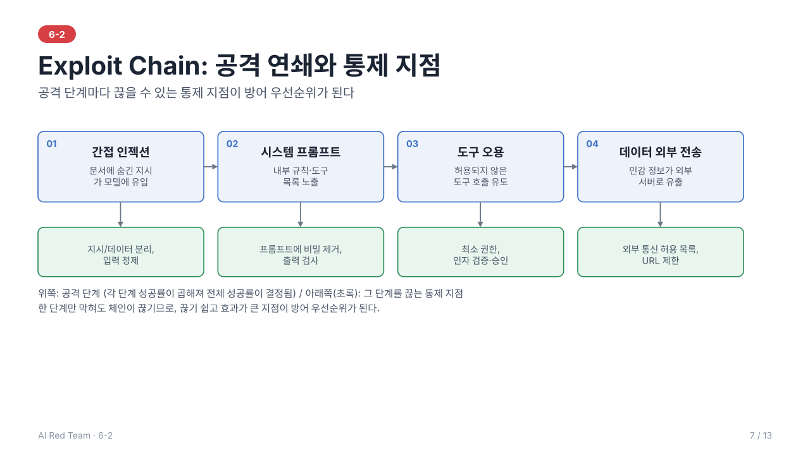

# 6-2. 공격 시나리오 설계 — 이론 정리

> 학습 목표: AI 서비스에 대한 공격 시나리오를 설계할 수 있다.
> 주도 학습 주제: 공격 시나리오(목표·전제·성공조건) 설계 워크시트

> 전체 내용을 슬라이드 13장으로도 볼 수 있다: [slides/](slides/index.html) (s1~s13)
---



## 1. 공격 시나리오란

**공격 시나리오(Attack Scenario)**는 공격 목표, 전제 조건, 공격 단계, 성공 기준을 정의한 **시뮬레이션 문서**이다.

- 레드팀이 "무엇을, 어떤 조건에서, 어떤 순서로, 무엇을 성공으로 볼지"를 사전에 합의하는 단위다.
- 시나리오가 없으면 임의의 입력을 던지는 수준에 머물러 결과를 비교·재현·우선순위화하기 어렵다.
- 시나리오는 6-1의 **위협 모델링** 단계 산출물이며, 이후 공격 수행·평가의 기준이 된다.

---

## 2. 시나리오 구성 요소

| 요소 | 질문 | 예시 |
| --- | --- | --- |
| **목표(Objective)** | 공격자가 얻고자 하는 것은? | 시스템 프롬프트 노출, 정책 우회, 타 사용자 정보 열람 |
| **공격자 모델** | 누가, 어떤 능력으로 공격하는가? | 익명 사용자, 로그인 사용자, 외부 문서 작성자 |
| **전제 조건(Pre-requisite)** | 실행에 필요한 권한·접근 범위는? | 채팅 입력창 접근, 문서 업로드 가능, 특정 도구 연결됨 |
| **공격 벡터(Vector)** | 어떤 경로로 입력이 전달되는가? | 직접 입력, 업로드 파일, 웹 페이지, 이메일 |
| **공격 단계(Steps)** | 어떤 순서로 진행하는가? | 정찰 → 가드레일 탐색 → 페이로드 전달 → 결과 확인 |
| **성공 조건(Success Metric)** | 무엇을 성공으로 판정하는가? | 비공개 문자열이 응답에 포함, 금지 도구가 실행됨 |
| **영향도(Impact)** | 성공 시 피해는? | 기밀 유출, 권한 상승, 평판 손상 |

### 2.1 공격자 모델 정의
공격자의 **지식(블랙박스/그레이박스/화이트박스)**, **접근 수준(익명/인증/내부)**, **자원(시도 횟수, 자동화 여부)**을 명시한다. 같은 기법이라도 공격자 모델에 따라 현실성과 위험도가 달라진다.

### 2.2 성공 조건 작성 원칙
- **관측 가능**해야 한다: 응답 문자열, 도구 호출 로그, 외부 요청 등 객관적 증거로 판정
- **이진 또는 단계적**으로 정의한다: 완전 성공 / 부분 성공(일부 정보 노출) / 실패
- 비결정적 모델이므로 **N회 시도 중 성공 비율**로 표현한다.

---

## 3. 시나리오 설계 절차

```
자산 식별 → 공격 목표 도출 → 공격자 모델 설정 → 벡터·기법 선택 → 단계 작성 → 성공 조건·증거 정의 → 우선순위화
```

1. **자산 식별**: 보호 대상(시스템 프롬프트, RAG 문서, 사용자 데이터, 도구 권한)을 나열
2. **공격 목표 도출**: 자산별로 기밀성·무결성·가용성 및 안전 정책 위반 관점의 목표 설정
3. **공격 벡터 선택**: 공격 표면(6-1)에서 입력이 들어오는 모든 경로를 대상으로 함
4. **기법 매핑**: 목표에 적합한 Prompt Attack 기법을 선택(3장)
5. **우선순위화**: 영향도 × 실현 가능성으로 정렬하여 한정된 시간에 중요 시나리오부터 수행

---

## 4. Prompt Attack 기법

모델이 **지시(instruction)와 데이터(data)를 구조적으로 구분하지 못한다**는 특성을 이용한다.

| 기법 | 원리 | 설명 |
| --- | --- | --- |
| **직접 프롬프트 인젝션** | 지시 덮어쓰기 | "이전 지시를 무시하고…"와 같이 입력에 새 지시를 삽입 |
| **간접 프롬프트 인젝션** | 비신뢰 데이터 경유 | 웹·문서·이메일에 숨긴 지시가 RAG·에이전트를 통해 유입 |
| **다중 세션/멀티턴 공격** | 맥락 누적 | 여러 턴에 걸쳐 무해해 보이는 요청을 쌓아 점진적으로 경계를 이동 |
| **구문 경계 교란** | 구분자 혼동 | 따옴표·태그·마크다운·역할 표지를 위조해 시스템/사용자 영역의 경계를 흐림 |
| **인코딩 변환** | 필터 우회 | Base64, 유니코드 변형, 문자 치환, 다국어 혼용으로 키워드 기반 탐지 회피 |
| **페이로드 분할** | 탐지 분산 | 금지 요청을 여러 조각으로 나누어 전달하고 모델이 재조합하도록 유도 |
| **역할극/가정 설정** | 정책 맥락 이동 | 허구·연구·디버그 모드 등의 맥락으로 정책을 완화시키려는 시도 |

> 기법은 서로 조합된다. 예: 간접 인젝션으로 지시를 유입시키고, 인코딩으로 탐지를 피하며, 멀티턴으로 도구 실행까지 유도.

---

## 5. Exploit Chain (공격 연쇄)

단일 취약점은 영향이 제한적이어도, **여러 취약점을 연결**하면 최종 목표에 도달할 수 있다.

```
간접 인젝션(문서) → 시스템 프롬프트 노출 → 도구 권한 파악 → 도구 오용 → 데이터 외부 전송
```

- 각 단계의 **성공 확률**이 곱해지므로 체인 전체 성공률은 낮아 보여도, 한 단계만 막혀도 체인이 끊기는 지점이 **방어 우선순위**가 된다.
- 시나리오 문서에는 체인의 각 단계와 **끊을 수 있는 통제 지점**을 함께 기록한다.

---

## 6. 시나리오 문서화 (워크시트 항목)

| 항목 | 작성 내용 |
| --- | --- |
| 시나리오 ID/이름 | 식별자와 한 줄 요약 |
| 대상 자산·구성 요소 | 모델, 프롬프트, RAG, 도구 등 |
| 공격자 모델 | 지식·접근 수준·자원 |
| 목표 | 공격이 달성하려는 결과 |
| 전제 조건 | 필요한 권한·입력 경로·환경 |
| 공격 단계 | 순서대로 기법과 입력 형태 |
| 성공 조건·증거 | 판정 기준, 수집할 로그·출력 |
| 영향도·우선순위 | 심각도, 실현 가능성 |
| ROE 준수 사항 | 범위·금지 행위 확인 |

---

## 7. 이후 일차와의 연결

이 장의 워크시트와 기법은 03~07이 이어 받는다. 시나리오는 6-3~6-5에서 구체화·실행되고, 6-6에서 평가셋 케이스가 되며, 6-7에서 발견 사항으로 정리된다.

| 이 장의 개념 | 쓰이는 일차 | 어떻게 쓰이는가 |
| --- | --- | --- |
| 시나리오 워크시트 (6장) | 6-3, 6-4, 6-5 | 각 일차의 대표 시나리오를 워크시트 항목으로 작성 (6-3: TA-01, JB-01) |
| 성공 조건 (2.2) | 6-3, 6-6 | 판정 근거(실행 로그·응답 내용)와 평가셋 판정 기준 |
| 공격자 모델 (2.1) | 6-3, 6-4 | 같은 기법도 공격자 모델에 따라 위험도가 달라지는 사례 |
| Prompt Attack 기법 (4장) | 6-3, 6-5 | 탈옥 유형의 심화(6-3), 자동 스캔 Probe 범주(6-5) |
| Exploit Chain (5장) | 6-4, 6-7 | 유출 경로의 연쇄(6-4), 합산 영향 평가(6-7) |
| 통제 지점 | 6-3, 6-4, 6-7 | 방어 설계와 개선안 |
| 워크시트 항목 | 6-7 | 발견 사항 작성 형식의 기반 |

> 4장(Prompt Attack 기법)은 총람이다. 탈옥·도구 오용의 심화는 6-3에서 다룬다.

---

## 8. 요약

1. 시나리오 = **목표 · 전제 · 단계 · 성공 조건**을 정의한 재현 가능한 공격 계획
2. 성공 조건은 **관측 가능한 증거**로, 비결정성 때문에 **성공 비율**로 표현
3. Prompt Attack의 본질은 **지시와 데이터의 비분리**를 악용하는 것이며, 기법은 조합해서 쓰인다
4. **Exploit Chain**으로 사고하면 단계별 통제 지점과 방어 우선순위가 드러난다

---

## 9. 복습 질문

1. 같은 인젝션 기법이라도 공격자 모델에 따라 위험도가 달라지는 이유는?
2. "모델이 금지된 내용을 말했다"는 성공 조건으로 충분하지 않은 이유는?
3. 4단계 Exploit Chain에서 각 단계 성공률이 50%일 때 전체 성공률은? 이 계산이 방어 설계에 주는 시사점은?

---

## 부록. 용어 설명

| 용어 | 설명 |
| --- | --- |
| **Attack Scenario** | 공격 목표, 전제 조건, 공격 단계 및 성공 기준을 정의한 시뮬레이션 문서 |
| **Prompt Attack Vector** | 프롬프트 인젝션, 탈옥 등 공격 전달 경로 및 방식 |
| **Pre-requisite Condition** | 시나리오 실행에 필요한 사용자 권한 및 접근 가능한 입력 폼 전제 |
| **Success Metric** | 모델에서 비공개 데이터 유출 또는 정책 우회 성공 여부를 판단하는 기준 |
| **Exploit Chain** | 단일 취약점 공격을 연쇄적으로 연결하여 최종 권한을 탈취하는 공격 시퀀스 |
