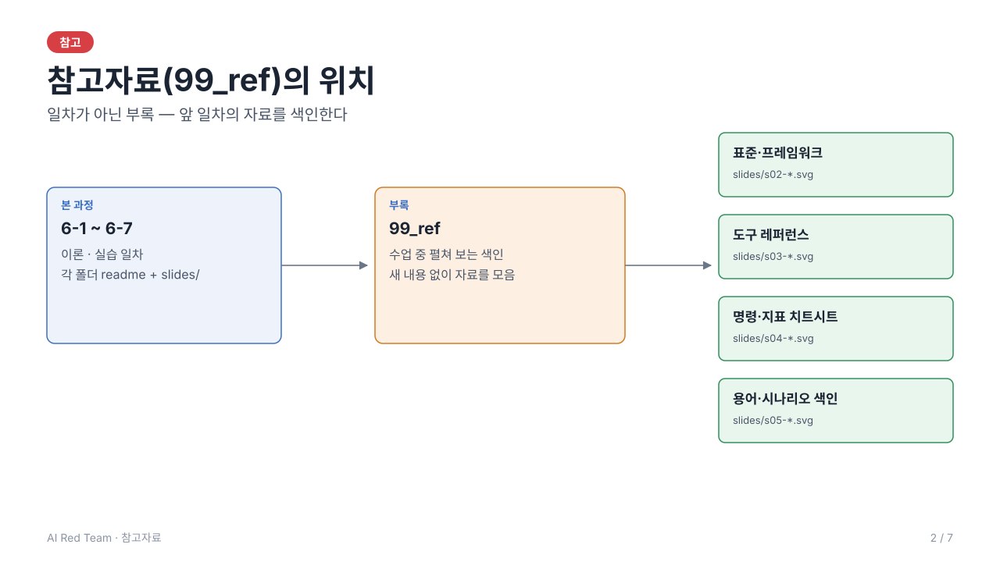

# 참고자료 — 표준 · 도구 · 명령 · 지표 · 용어 색인

> 이 폴더는 일차가 아니라 부록이다. 새 내용 없이 6-1~6-7의 자료를 한곳에 모아 색인한다.
> 수업 중 빠르게 찾아볼 때 쓰고, 원문은 각 일차 readme.md와 slides/에 있다.



슬라이드로 보려면 [slides/](slides/index.html) (s1~s7).

## 1. 외부 표준·프레임워크

| 프레임워크 | 답하는 질문 | 과정에서의 위치 |
| --- | --- | --- |
| OWASP Top 10 for LLM Applications (2025) | 무엇이 위험한가 — 위험 목록 | 6-1 5.1 · 6-3 LLM06 · 6-4 LLM02·LLM07 |
| MITRE ATLAS | 공격이 어떻게 진행되는가 — 절차·TTP | 6-1 5.2 · 공격 단계 분류 근거 |
| NIST AI RMF | 조직이 어떻게 관리하는가 — 관리 체계 | 6-1 5.3 · ROE·거버넌스 근거 |

버전에 따라 항목 번호·이름이 달라진다 — 인용 전 공식 문서에서 확인한다 (6-1 작성 규칙과 동일).

## 2. 도구 레퍼런스

| 도구 | 역할 | 쓰이는 일차 |
| --- | --- | --- |
| Ollama | 로컬 LLM 실행 — 모델·테스트 입력이 외부로 나가지 않게 한다 | 6-3 ~ 6-5 실습 전제 |
| Garak | 취약점 스캐너 — probe·detector로 공격 페이로드를 대량 전송 | 6-5 |
| PyRIT | 공격 시나리오 자동화 프레임워크 | 6-5 |
| LangChain | 모델 → 방어 체인, ACL 검색기 RAG 구성 | 6-4 |
| LangGraph | 평가 그래프 — 호출 → 방어 → 집계 → 합격 게이트 | 6-5 |

설치·실행 절차는 루트 readme.md의 "LLM 실행 가이드 (Ollama)" 절을 따른다.

## 3. 명령 치트시트

모든 명령은 저장소 루트에서 실행한다.

```bash
# 환경 준비
source .venv/bin/activate
pip install -r requirements.txt        # 처음 한 번
ollama serve                           # 별도 터미널에서 계속 실행
ollama pull qwen2.5:3b                 # 약 2GB, 한 번만
python 03_jailbreak_tool_abuse_testing/src/llm.py   # 준비 확인
```

```bash
# 일차별 실행
python 03_jailbreak_tool_abuse_testing/src/harness.py \
    --hypothesis results/hypothesis-ch03.json --json results/ch03.json
python -W ignore -m unittest -v 04_data_exfiltration_validation/src/test_chain.py
python -W ignore -m unittest -v 05_garak_pyrit_automated_testing/src/test_graph.py
python 06_evaluation_set_defense_rate/src/run/evalset.py --max-asr 0.2 --max-fpr 0.1
python 07_redteam_result_analysis/src/run/from_harness.py results/ch03.json -o results/run.json
python 07_redteam_result_analysis/src/run/report.py results/run.json
```

모델 교체는 `OLLAMA_MODEL=llama3.2:3b python …`, `QUICK=1`은 반복 1/3 동작 확인용(통계 결론 아님).

## 4. 지표 치트시트

| 지표 | 정의 |
| --- | --- |
| ASR 공격 성공률 | 성공한 공격 ÷ 전체 시도 — 하네스·게이트 |
| 방어율 | 차단 ÷ 전체 공격 (= 1 − ASR) |
| 오탐률 FPR | 정상 입력을 차단한 비율 |
| Wilson 95% CI | 성공 비율의 신뢰구간 — `stats.py` |

해석 규칙: n=30에서 0건이면 95% 상한 ≈ 11% — 0건은 "안전"이 아니라 "상한 이하". 50% 부근 구간 폭 ≈ ±17%p이므로 구간이 겹치면 차이를 단정하지 않는다. 반복 횟수: TA-01 30회 · JB-01 15회(시도당 4턴) · 오탐 30건 · 6-5 평가 그래프 공격·정상 각 30건.

## 5. 용어·시나리오 색인

| 시나리오 ID | 내용 | 일차 |
| --- | --- | --- |
| TA-01 | 외부 문서 경유 도구 무단 실행 | 6-3 |
| JB-01 | 멀티턴 유도에 대한 정책 유지 | 6-3 |
| EX-01 | Data Exfiltration 검증 | 6-4 |
| AU-01 | 자동화 검증 실행·해석 | 6-5 |

- 용어 설명은 각 일차 readme.md의 "부록. 용어 설명" 절에 있다 (슬라이드로는 각 일차의 sNN-glossary 장).
- 가설 예시: `NN_일차/src/hypothesis.example.json` (`cp -n`으로 복사해 고친다)
- 시나리오 워크시트: `NN_일차/src/scenarios/chNN_*.json`
- 실행 결과: `results/` (예제는 `results/example/`, 읽기용)
- 가설 대조: `python NN_일차/src/hypothesis_log.py results/chNN.json`
