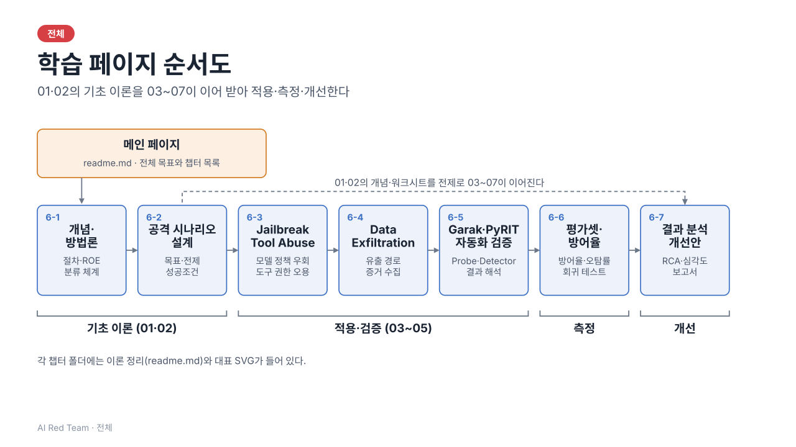

# 전체 목표



**목표:** 공격자 관점에서 AI 서비스 취약점을 검증하고, 공격 유형별 방어율을 측정한다.

#### 학습 내용

- **AI 레드티밍(Red Teaming)의 이해**
    - 전통적 모의해킹과 AI 레드팀의 차이, AI 레드팀 운영 프로세스
- **AI 공격 시나리오 기획**
    - Prompt Attack, Tool Abuse, Data Exfiltration 등 특화 공격 시나리오 수립
- **취약점 검증 자동화 도구 활용**
    - Garak, PyRIT(Python Risk Identification Tool for generative AI) 등 검증 도구 활용
- **평가셋 구축 및 방어율 측정**
    - 자사 모델/서비스 평가를 위한 맞춤형 벤치마크 및 평가셋 구축 방안
    - 공격 유형별 보안 방어율 지표 설정 및 측정

#### 실습: AI 레드팀 모의 해킹

1. 로컬 환경에 타겟 AI API 챗봇 서버 구동하기
2. 보안 테스팅 도구 Garak 설치 및 설정 파일(Target API 엔드포인트 연동) 구성하기
3. Garak의 `jailbreak`, `prompt_injection` 모듈을 실행하여 수백 건의 공격 페이로드 전송하기
4. 공격 성공률 리포트를 확인하고 탈옥(Jailbreak)에 성공한 프롬프트 패턴 도출하기

```bash
cd src && python app.py
```

# 일차 목록

| 일차 | 학습 목표 | 주도 학습 주제 | 이론 정리 |
| --- | --- | --- | --- |
| 6-1. AI 레드팀 개념과 방법론 | AI 레드팀의 개념과 절차를 이해할 수 있다. | AI 레드팀 범위·규칙(ROE) 및 방법론 요약 작성 | [01_ai_redteam_concept_methodology](01_ai_redteam_concept_methodology/readme.md) |
| 6-2. 공격 시나리오 설계 | AI 서비스에 대한 공격 시나리오를 설계할 수 있다. | 공격 시나리오(목표·전제·성공조건) 설계 워크시트 | [02_attack_scenario_design](02_attack_scenario_design/readme.md) |
| 6-3. Jailbreak·Tool Abuse 테스트 | Jailbreak와 Tool Abuse 공격을 테스트할 수 있다. | Jailbreak·Tool Abuse 테스트 케이스 실행 및 결과 기록 | [03_jailbreak_tool_abuse_testing](03_jailbreak_tool_abuse_testing/readme.md) |
| 6-4. Data Exfiltration 시나리오 검증 | 데이터 탈취 시나리오를 검증할 수 있다. | Data Exfiltration 시나리오 검증 및 증거 수집 | [04_data_exfiltration_validation](04_data_exfiltration_validation/readme.md) |
| 6-5. Garak·PyRIT 기반 자동화 검증 | Garak, PyRIT 등 도구로 취약점 검증을 자동화할 수 있다. | Garak·PyRIT 등 도구로 자동화 스캔 실행·결과 해석 | [05_garak_pyrit_automated_testing](05_garak_pyrit_automated_testing/readme.md) |
| 6-6. 평가셋 구성 및 방어율 측정 | 공격 유형별 평가셋을 구성하고 방어율을 측정할 수 있다. | 공격 유형별 평가셋 구성 및 방어율 측정 실습 | [06_evaluation_set_defense_rate](06_evaluation_set_defense_rate/readme.md) |
| 6-7. 레드팀 결과 분석 실습 | 레드팀 결과를 분석하고 개선안을 도출할 수 있다. | 레드팀 결과 분석 및 개선안 도출 리포트 | [07_redteam_result_analysis](07_redteam_result_analysis/readme.md) |

각 일차 폴더에는 이론 정리 `readme.md`가 있고, 용어 설명은 각 이론 정리의 부록에 있다. 슬라이드는 각 일차의 `slides/`에 있고, 전체 목차는 [index.html](index.html)이다(브라우저로 열면 일차별 프레젠터로 이동한다). 슬라이드를 만드는 규칙과 AI 프롬프트는 아래 "작성 규칙 > SVG 메타프롬프트"에 있다.

**일차 구성**: 01·02는 뒤 일차의 기초 이론이다. 01(개념·절차·ROE·분류 체계)과 02(시나리오 워크시트·기법·Exploit Chain)는 각각 "이후 일차와의 연결" 절에서 03~07 어디에 쓰이는지 정리하고, 03~07 문서는 맨 앞에 "선행 개념"을 두어 01·02의 어느 절을 전제로 하는지 밝힌다. 공격 유형·지표·방어 원칙 같은 상세 내용은 해당 일차에서만 다루고, 01·02에서는 개요만 둔다.

**부록**: [99_ref](99_ref/readme.md) — 일차가 아닌 참고자료. 외부 표준 색인, 도구 레퍼런스, 명령·지표 치트시트, 용어·시나리오 ID 색인을 모아 둔다.

# 실습 코드

| 폴더 | 내용 | 실행 |
| --- | --- | --- |
| [03_jailbreak_tool_abuse_testing/src/](03_jailbreak_tool_abuse_testing/src/) | 6-3 도구 호출 방어 모듈(`tool_guard.py`) 단위 테스트 (모델 호출 없음) | python -m unittest -v 03_jailbreak_tool_abuse_testing/src/test_tool_guard.py |
| [03_jailbreak_tool_abuse_testing/src/](03_jailbreak_tool_abuse_testing/src/) | 6-3 하네스(`harness.py`): 실제 Ollama 모델로 TA-01·JB-01을 N회 실행하고, 같은 출력에 통제 ON/OFF를 적용해 성공 비율과 증거를 JSON으로 기록. 실행 전 가설과 결과의 대조(`hypothesis_log.py`, 가설 예시 `hypothesis.example.json`) 지원 | python 03_jailbreak_tool_abuse_testing/src/harness.py --hypothesis results/hypothesis-ch03.json --json results/ch03.json |
| [03_jailbreak_tool_abuse_testing/src/](03_jailbreak_tool_abuse_testing/src/) | 6-2 시나리오 워크시트(`scenarios/ch03_*.json`)를 읽어 실제 모델로 실행하는 러너(`scenario.py`). 방어 전/후 성공 비율과 리포트 출력 | python -m unittest -v 03_jailbreak_tool_abuse_testing/src/test_scenario.py |
| [04_data_exfiltration_validation/src/](04_data_exfiltration_validation/src/) | 6-4 방어 모듈(`defense.py`) 단위 테스트 (모델 호출 없음) | python -m unittest -v 04_data_exfiltration_validation/src/test_defense.py |
| [04_data_exfiltration_validation/src/](04_data_exfiltration_validation/src/) | 6-4 LangChain(모델 → 방어 체인, ACL 검색기 RAG)을 실제 Ollama 모델로 실행. 가설 예시 `hypothesis.example.json` | python -W ignore -m unittest -v 04_data_exfiltration_validation/src/test_chain.py |
| [05_garak_pyrit_automated_testing/src/](05_garak_pyrit_automated_testing/src/) | 6-5 방어 모듈(`defense.py`) 단위 테스트 (모델 호출 없음) | python -m unittest -v 05_garak_pyrit_automated_testing/src/test_defense.py |
| [05_garak_pyrit_automated_testing/src/](05_garak_pyrit_automated_testing/src/) | 6-5 LangGraph(모델 호출 → 방어 → 집계 → 합격/불합격 게이트)를 실제 Ollama 모델로 실행. 가설 예시 `hypothesis.example.json` | python -W ignore -m unittest -v 05_garak_pyrit_automated_testing/src/test_graph.py |
| [06_evaluation_set_defense_rate/src/](06_evaluation_set_defense_rate/src/) | 6-6 평가셋 도구(`evalset.py`): 케이스 JSON을 검증하고, 차단 결과로 방어율·공격 성공률·오탐률·유형별·심각도 가중 방어율을 Wilson 95% 구간과 함께 계산하고 합격 기준(게이트)을 판정 (모델 호출 없음) | python 06_evaluation_set_defense_rate/src/evalset.py --max-asr 0.2 --max-fpr 0.1 |
| [07_redteam_result_analysis/src/](07_redteam_result_analysis/src/) | 6-7 보고서 생성기(`report.py`): 하네스 결과(JSON)와 시나리오 워크시트를 6-7 형식의 Markdown 보고서 초안으로 만든다. 독자별 출력, 개선 전후 비교, 가설 대비 결과 표시 지원. 예시: [sample-report.md](07_redteam_result_analysis/sample-report.md) | python 07_redteam_result_analysis/src/report.py results/ch03.json |

**일차별 코드**: 03~07 일차 폴더의 `src/`는 각각 그 일차 실습에 필요한 코드를 모두 갖는다. `stats.py`(신뢰구간), `llm.py`(Ollama 호출), `hypothesis_log.py`(가설 대조), `defense.py`는 여러 일차에 같은 내용의 복사본이 따로 있다. 앞 일차에 결석한 학생도 다른 일차의 코드 없이 해당 일차부터 실습을 따라갈 수 있게 하기 위해서다. 한 일차에서 고친 내용은 다른 일차에 자동으로 반영되지 않는다. 모든 실습은 저장소 루트에서 실행한다(`python NN_일차/src/…`). 실행 결과는 루트의 `results/`에 저장하고, 패키지는 루트의 `requirements.txt`와 `.venv` 하나를 함께 쓴다. 테스트는 한 번에 한 일차만 실행한다(복사본의 모듈 이름이 같아 여러 일차의 테스트를 한 프로세스에서 섞어 돌리면 안 된다). 01·02는 이론 일차라 `src/`에 안내 `README.md`만 있다.

**결과 파일**: 예제 결과는 `results/example/`에 있고(읽기용, 수정하지 않는다), 직접 실행한 결과는 `results/`에 저장한다. 같은 이름으로 다시 저장해도 이전 파일은 지워지지 않고 `results/history/`로 옮겨지며, 저장은 임시 파일을 거쳐 바꿔치기해서 중간에 끊겨도 반쪽 파일이 남지 않는다. 가설 파일은 복사할 때 `cp -n`으로 이미 고친 파일을 덮어쓰지 않게 한다. `results/`는 예제를 빼고 `.gitignore`로 제외한다.

- 모델 실습(03 하네스·시나리오 러너, 04 `test_chain.py`·05 `test_graph.py`)은 로컬 Ollama가 필요하다: `ollama serve` 실행 후 `ollama pull qwen2.5:3b`(약 2GB). `OLLAMA_MODEL`로 모델을 고르며, 없으면 qwen2.5:3b, 그것도 없으면 설치된 첫 모델을 쓴다. 서버가 꺼져 있으면 해당 테스트만 건너뛴다.
- **모델 크기**: 학습용은 2~4B 급을 권장한다. 7B 이상은 반복 실습 시간이 몇 배로 늘어난다. TA-01은 도구 호출을 지원하는 모델이어야 하며(qwen2.5:3b, llama3.2:3b), gemma3는 Ollama에서 도구 호출을 지원하지 않는다. 1.5B 급 미세조정 모델은 호출 형식을 지키지 못해 TA-01이 0/30으로 나왔다.
- **반복 정량화**: 모든 모델 실습은 반복 실행한 성공 비율을 Wilson 95% 신뢰구간과 함께 보고한다(`stats.py`). 기준 횟수는 TA-01 30회, JB-01 15회(시도당 4턴), 정상 질문 오탐률 30건, 6-5 평가 그래프 공격·정상 각 30건이다. 30회면 0건일 때 95% 상한이 약 11%이고, 50% 근처의 구간 폭은 약 ±17%p이다. 전체 실행은 소형 모델에서 약 3분 걸리며, `QUICK=1`이면 횟수를 1/3로 줄여 동작만 확인한다(통계적 결론용이 아님). 0건은 "안전"이 아니라 "상한 이하"이고, 구간이 겹치면 차이가 있다고 단정하지 않는다.
- **모든 실습은 저장소 루트의 Python 가상환경(`.venv`)에서 실행한다.** Python 3.10 이상과 `pip install -r requirements.txt`를 쓴다(LangChain/LangGraph 테스트에 필요). 명령은 `python`이다. 만드는 법은 아래 LLM 실행 가이드의 0번을 따른다.
- 구조도: 6-4 LangChain 적용 구조는 [슬라이드 s14](04_data_exfiltration_validation/slides/index.html#14), 6-5 LangGraph 평가 그래프는 [슬라이드 s21](05_garak_pyrit_automated_testing/slides/index.html#21)
- 모델 출력은 비결정적이므로 성공률은 실행마다 달라질 수 있다(seed로 재현을 시도). 테스트 입력은 더미 카나리와 예약 도메인(`.invalid`)을 쓰고, 공격 페이로드는 만들지 않는다.

# LLM 실행 가이드 (Ollama)

6-3~6-5의 모델 실습은 **로컬에서 LLM이 실행 중**이어야 한다. 모델은 내 컴퓨터에서만 돌고, 테스트 입력이 외부 서비스로 나가지 않는다.

**0. 가상환경** — 모든 실습 명령은 저장소 루트에서, 가상환경을 활성화한 상태로 실행한다. 가상환경은 루트의 `.venv`(Python 3.12)이고 `.gitignore`로 제외한다. 시스템 Python은 버전이 낮거나 패키지가 없어 테스트가 건너뜀으로 끝날 수 있다.

```
# 처음 한 번 (Python 3.10 이상, macOS: brew install python@3.12)
python -m venv .venv
source .venv/bin/activate
pip install -r requirements.txt           # 같은 버전 재현: 아래 "같은 버전으로 재현"

# 실습할 때마다 (저장소 루트에서)
source .venv/bin/activate
python --version                                # 3.10 이상, 프롬프트 앞에 (.venv)
```

**같은 버전으로 재현** — 새 버전 때문에 실습이 깨지면 아래 버전(Python 3.12, macOS arm64, 2026-11-04에 동작 확인)으로 설치한다. 별도 파일 없이 붙여 넣어 실행한다. 다른 OS에서 맞지 않는 패키지가 있으면 `requirements.txt`로 설치한다.

```
pip install -r /dev/stdin <<'EOF'
annotated-types==0.8.0
anyio==4.16.0
certifi==2026.10.23
charset-normalizer==3.5.2
distro==1.9.0
h11==0.16.0
httpcore==1.0.9
httpcore2==2.16.0
httpx==0.28.1
httpx2==2.16.0
idna==3.20
jsonpatch==1.41
jsonpointer==3.8
langchain-core==1.7.4
langchain-ollama==1.1.0
langchain-protocol==0.0.20
langgraph==1.2.19
langgraph-checkpoint==4.3.1
langgraph-prebuilt==1.1.1
langgraph-sdk==0.4.12
langsmith==0.14.17
ollama==0.6.3
orjson==3.13.0
ormsgpack==1.13.0
packaging==26.3
pydantic==2.14.2
pydantic_core==2.50.2
PyYAML==6.0.3
requests==2.34.2
requests-toolbelt==1.0.0
sniffio==1.3.1
tenacity==9.2.1
truststore==0.10.5
typing-inspection==0.4.4
typing_extensions==4.16.0
urllib3==2.8.0
uuid_utils==0.19.0
websockets==17.4
xxhash==4.0.2
zstandard==0.25.0
EOF
```

구글 드라이브 안에 두므로 `.venv`(약 60MB, 파일 수천 개)가 동기화 대상이 된다. 동기화가 느리면 드라이브 앱에서 `.venv` 폴더를 동기화에서 제외한다.

**1. 설치** — macOS: `brew install ollama` (또는 [ollama.com/download](https://ollama.com/download)의 앱). Linux·Windows도 같은 사이트의 설치 방법을 따른다.

**2. 서버 실행** — 터미널 하나를 열어 `ollama serve`를 실행하고 계속 켜 둔다. 앱으로 설치했다면 이미 실행 중일 수 있다. 이미 떠 있는데 다시 실행하면 포트 사용 중 오류가 나는데, 그대로 쓰면 된다. 끝낼 때는 그 터미널에서 `Ctrl+C`.

**3. 모델 받기** — `ollama pull qwen2.5:3b` (약 2GB, 한 번만). 디스크와 메모리에 모델 크기 이상의 여유가 필요하다. 모델 선택 기준은 아래 "모델 크기"를 따른다.

**4. 준비 확인** — 저장소 루트에서 다음을 실행한다.

```
python 03_jailbreak_tool_abuse_testing/src/llm.py
# (True, '', 'qwen2.5:3b') 이면 준비 완료
```

`ollama list`로 받은 모델을 볼 수 있다. `(False, 사유, None)`이 나오면 아래 표를 본다.

**5. 실습 실행** — 0번의 가상환경을 활성화한 상태에서 실습 코드 표의 명령을 실행한다. 모델을 바꾸려면 `OLLAMA_MODEL=llama3.2:3b python 03_jailbreak_tool_abuse_testing/src/harness.py`처럼 환경 변수를 지정한다. 다른 주소의 서버는 `OLLAMA_BASE_URL`로 지정한다(기본 `http://localhost:11434`).

| 메시지·증상 | 원인 | 조치 |
| --- | --- | --- |
| Ollama 서버에 연결할 수 없음 | 서버가 꺼져 있음 | `ollama serve` |
| 모델 미설치 / 설치된 모델이 없음 | 모델을 받지 않음 | `ollama pull qwen2.5:3b` |
| 테스트가 "건너뜀(skipped)"으로 끝남 | 위 둘 중 하나. **통과가 아니라 실습을 하지 않은 것** | 준비 확인에서 `True`를 확인한 뒤 다시 실행 |
| TA-01이 0/30으로 나옴 | 도구 호출을 지원하지 않거나 형식을 지키지 못하는 모델 | qwen2.5:3b, llama3.2:3b로 교체 |
| 너무 오래 걸림 | 모델이 큼(7B 이상) 또는 반복 횟수 | 2~4B 급으로 교체, 동작 확인만이면 `QUICK=1` |

# 작성 규칙

## 폴더·파일

- 일차 폴더는 `NN_영문_소문자_스네이크` 형식의 영어 이름을 쓴다. (예: `01_ai_redteam_concept_methodology`)
- 부록 폴더(`99_ref`)도 같은 이름 규칙을 쓰지만 일차 목록에는 넣지 않고 별도 안내로 연결한다.
- 폴더마다 이론 정리 `readme.md`를 둔다. 도표 SVG는 모두 `slides/`에 슬라이드로 둔다(일차 루트에 따로 두지 않는다). 메인 `readme.md`는 인덱스(메인 페이지)로만 쓰고, 이론 본문은 각 일차 폴더에 둔다.
- 01·02는 기초 이론이므로 "이후 일차와의 연결" 절을 두고, 03~07은 "선행 개념"과 "6-2 시나리오 설계 적용" 절을 둔다. 같은 내용은 한 일차에서만 상세히 다루고 나머지는 연결한다.
- 메인 `readme.md`에서 일차 `readme.md`로 링크를 걸고, 이미지는 같은 폴더 안의 상대 경로로 참조한다.
- 폴더 이름을 바꾼 뒤에는 링크가 깨지지 않았는지 확인한다.
- 메인 `readme.md`의 일차 목록과 실습 코드 표를 함께 갱신한다. 일차별 용어·이론 본문은 메인에 다시 적지 않는다.
- 실습 코드는 각 일차 폴더의 `src/`에 두고, 라이브러리별(LangChain/LangGraph) 폴더를 따로 만들지 않는다.
- 여러 일차가 쓰는 코드도 공유하지 않고 일차 폴더마다 복사본을 둔다. 앞 일차를 놓친 학생도 그 일차부터 실습할 수 있게 하기 위해서다.
- 실습은 저장소 루트에서 `python NN_일차/src/…`로 실행한다. 실행 결과는 루트 `results/`에, 패키지 목록은 루트 `requirements.txt`에 두고 `.venv`도 루트에 하나만 만든다. 명령은 `python3`이 아니라 `python`을 쓴다.
- `src/`에는 `__init__.py`를 두지 않고, 테스트는 저장소 루트에서 한 번에 한 일차씩 `python -m unittest -v NN_일차/src/test_….py`로 실행한다.

## 명명법

| 대상 | 규칙 | 예 |
| --- | --- | --- |
| 일차 폴더 | `NN_영문_스네이크` | `03_jailbreak_tool_abuse_testing` |
| 실습 폴더 | `NN_일차/src/` (일차 폴더 안) | `03_jailbreak_tool_abuse_testing/src/` |
| 소스 모듈 | `이름.py` (일차의 `src/` 안에 둔다. 소속은 폴더가 나타낸다) | `03_…/src/tool_guard.py`, `03_…/src/harness.py` |
| 여러 일차가 쓰는 모듈 | 같은 이름으로 일차마다 복사 | `stats.py`, `llm.py`, `defense.py` |
| 테스트 | `test_` + 대상 모듈 이름 | `test_tool_guard.py`, `test_defense.py` |
| 시나리오 워크시트 | `scenarios/chNN_시나리오ID.json` (ID는 소문자) | `scenarios/ch03_ta01.json` |
| 슬라이드 SVG | `NN_일차/slides/sNN-이름.svg` | `03_…/slides/s07-attack-chain.svg` |
| 슬라이드 HTML | `NN_일차/slides/index.html` (그 일차 SVG를 넘겨 보는 프레젠터), 전체 목차는 루트 `index.html` | `03_…/slides/index.html` |

- Python 폴더는 숫자로 시작할 수 없으므로 `03_`이 아니라 `ch03`을 쓴다. 파이썬 파일은 밑줄(`_`), SVG는 하이픈(`-`)으로 구분한다. `ollama.py`·`hypothesis.py`처럼 설치되는 패키지와 이름이 같은 모듈은 만들지 않는다(그림자 문제).
- 이름에 라이브러리 이름(langchain, langgraph)을 넣지 않고 일차 번호로 소속을 나타낸다. 라이브러리는 파일 안에서 구분한다.
- 클래스는 `PascalCase`, 함수·변수는 `snake_case`, 상수는 `UPPER_SNAKE`를 쓴다. 시나리오 ID(`TA-01`, `JB-01`, `EX-01`, `AU-01`)는 대문자와 하이픈이다.
- 파일 이름을 바꾸면 import, 실행 경로 주석, 메인 readme의 실습 코드 표, 일차 readme의 링크를 함께 고친다.

## 이론 문서(readme.md) 구성

- 제목은 `# 6-N. 일차명 — 이론 정리`, 바로 아래에 학습 목표와 주도 학습 주제를 인용문으로 적는다.
- 본문은 번호 매긴 장으로 쓰고, 요약, 복습 질문, 부록(용어 설명) 순서로 마무리한다.
- 01·02는 이론만 다룬다. 실습(Lab)과 보고서 템플릿은 넣지 않는다.
- 03~06은 실습 일차다. 이론에 더해 실습 안내(순서·실행 방법·결과 읽는 법)를 "실습" 절로 복습 질문 앞에 둔다. 실행 명령은 메인 readme의 실습 코드 표와 일치시킨다.
- 07은 결과 분석·보고서 일차다. 보고서 템플릿과 보고서 생성 도구 안내를 넣을 수 있다. 보고서 템플릿은 07에만 둔다.
- 외부 표준(OWASP, MITRE ATLAS, NIST 등)은 출처를 확인하고, 버전에 따라 바뀌는 내용은 공식 문서를 확인하라고 적는다.
- 용어는 "탈옥(Jailbreak)"처럼 통일한다. ("제일브레이크" 사용 금지)

## SVG (슬라이드 형태)

- 캔버스는 16:9(1280×720)로 한다.
- 구성은 왼쪽 위 일차 표시(`6-N`), 큰 제목, 한 줄 요약, 본문 도식, 하단 푸터 순서로 한다.
- 색상은 파랑(기본), 주황(핵심·전제), 초록(방어·통제), 빨강(일차 표시)을 쓰고, 다크 모드를 지원한다.
- 도식은 실제 메커니즘(흐름, 구조, 관계)을 보여 준다. 장식용 그림은 넣지 않는다.
- 접근성을 위해 `<title>`과 `<desc>`를 넣는다.
- 이론 문서 전체를 슬라이드로 옮긴 일차(01~07)는 각 일차 폴더의 `slides/`에 `sNN-이름.svg` 순서대로 두고 같은 폴더의 `index.html`(HTML 프레젠터)로 넘겨 본다. 전체 목차는 저장소 루트의 `index.html`이다.  우측 하단 푸터에 페이지 번호(`n / 총장수`)를 단다. 01은 19장, 02는 13장, 03은 35장(실습 14장 포함), 04는 27장(실습 11장 포함), 05는 25장(실습 10장 포함), 06은 19장(실습 3장 포함), 07은 23장(보고서 생성 실습 3장 포함)이다.
- 완성 후 렌더링해서 글자 겹침과 잘림을 확인한다.

## SVG 메타프롬프트

이 저장소의 슬라이드·도식 SVG를 AI에게 만들게 할 때 쓰는 프롬프트다. 아래 `프롬프트` 블록을 그대로 붙여 넣고 `{{ }}` 칸만 채운다. 규칙의 근거는 위 "SVG (슬라이드 형태)"이고, 둘이 다르면 그 절이 우선한다.

### 파일 위치

| 대상 | 위치 |
| --- | --- |
| 슬라이드 SVG | `NN_일차/slides/sNN-이름.svg` (소문자-하이픈, NN은 두 자리 순번) |
| 슬라이드 프레젠터 | `NN_일차/slides/index.html` (그 일차의 SVG를 넘겨 보는 HTML) |
| 전체 목차 | 루트 `index.html` |
| 기준 파일 | `02_attack_scenario_design/slides/s01-title.svg` |

- 프레젠터와 목차는 SVG 목록을 HTML 안에 담고 있다. 슬라이드를 추가·삭제·이름 변경한 뒤에는 이 목록을 다시 만든다(만들지 않으면 장 수와 순서가 어긋난다).
- 원본 SVG를 슬라이드로 흡수했다면 슬라이드가 원본 내용을 모두 담았는지 확인한 뒤 원본을 지운다(보관용 폴더를 두지 않는다).

### 쓰는 법

1. 만들 슬라이드의 **원문**(일차 `readme.md`의 해당 절)을 AI에게 함께 준다. 슬라이드는 원문의 변환이어야 하고 새 내용을 지어내지 않는다.
2. 기준 파일 `02_attack_scenario_design/slides/s01-title.svg`도 함께 준다(스타일 블록과 공통 배치의 기준이다).
3. 결과를 받으면 아래 "검수"를 실행한다. 눈으로 보는 렌더링 확인은 생략하지 않는다.

### 프롬프트

```text
너는 AI 레드팀 학습 자료의 SVG 슬라이드를 만드는 작성자다. 아래 원문을 슬라이드 {{N}}장으로 옮겨라.

[입력]
- 일차: {{6-N 표시}}  / 제목: {{슬라이드 제목}}  / 한 줄 요약: {{요약}}
- 원문(변환 대상): {{readme의 절 본문}}
- 기준 파일: s01-title.svg (스타일 블록과 chip·제목·푸터 배치를 그대로 쓴다)

[캔버스와 구성]
- viewBox 0 0 1280 720 (16:9). 위에서 아래로: 일차 chip(`6-N`, 빨강) → 큰 제목 → 한 줄 요약 → 본문 도식 → 우측 하단 푸터 `n / 총장수`.
- 본문 영역의 좌우 여백은 60px, 푸터와 겹치지 않게 아래 여백을 둔다(본문은 y 690 이내).
- `<svg>`에 role="img", aria-labelledby, 그리고 `<title>`·`<desc>`를 넣는다. title은 슬라이드 제목(프레젠터의 장 목록에 그대로 쓰인다), desc는 이 슬라이드가 보여 주는 내용 한두 문장이다.
- 글꼴은 `-apple-system, 'Apple SD Gothic Neo', 'Noto Sans KR', sans-serif`. 외부 폰트·이미지·스크립트·링크는 쓰지 않는다.

[색과 다크 모드]
- 파랑=기본, 주황=핵심·전제, 초록=방어·통제, 빨강=일차 표시와 경고. 의미 없는 색은 쓰지 않는다.
- 색은 `<style>`의 클래스로만 지정하고(인라인 fill 금지), 모든 클래스에 `@media (prefers-color-scheme: dark)` 짝을 둔다. 배경 `.bg` 사각형을 항상 깐다.
- 색만으로 의미를 전하지 않는다. 라벨·번호·아이콘 문자를 함께 쓴다.

[내용 규칙]
- 도식은 실제 메커니즘(흐름, 구조, 관계, 판정 기준)을 보여 준다. 장식용 그림은 넣지 않는다.
- 한 슬라이드에는 한 메시지만 담는다. 글이 많으면 슬라이드를 나눈다(박스 안 글이 3줄을 넘으면 나눔을 먼저 고려한다).
- 원문에 없는 수치·사실·명령을 만들지 않는다. 숫자와 명령어는 원문 그대로 옮긴다.
- 명령어와 출력은 어두운 코드 블록(`.cmdbg`, `.cmd`, 고정폭)에 넣는다. 실제로 실행해서 얻은 출력만 싣는다.
- 실습 명령은 저장소 루트 기준으로 `python NN_일차/src/…` 형태로 쓴다(`python3`와 `cd`는 쓰지 않는다). 한 줄이 약 58자를 넘으면 공백에서 줄바꿈한다.
- 용어는 "탈옥(Jailbreak)"처럼 통일한다. 실습 장은 원문의 단계 번호와 번호 원(①②)을 슬라이드에서도 같게 쓴다.
- 공격 예시는 중립적인 더미 문구와 예약 도메인(`.invalid`)만 쓴다. 실제로 쓸 수 있는 유해 프롬프트·자격증명·개인정보는 넣지 않는다.

[글자 크기와 줄바꿈]
- 본문 16px 이상, 제목 40px, 요약 20px, 표 17px, 각주 14px 이상. 그보다 작게 줄이지 않는다. 글이 넘치면 줄이지 말고 줄바꿈하거나 슬라이드를 나눈다.
- SVG는 자동 줄바꿈이 없다. 한 줄씩 `<text>`를 따로 쓰고, 줄 높이는 글자 크기의 1.5배 이상으로 한다.
- 폭 추정: 한글 1자 ≈ 글자 크기 × 1.0, 영문 소문자 ≈ 0.56, 대문자·숫자 ≈ 0.62, 공백 ≈ 0.32. 박스 폭에서 좌우 안쪽 여백 16px씩을 뺀 값을 넘으면 줄을 바꾼다.
- 박스 높이는 (줄 수 × 줄 높이 + 제목 + 위아래 여백)으로 계산해 정한다. 글이 박스 밖으로 나가지 않아야 한다.

[이름과 파일]
- 슬라이드는 `NN_일차/slides/sNN-이름.svg`에 둔다. 장수가 바뀌면 모든 슬라이드의 푸터 `n / 총장수`와 readme의 장수·슬라이드 번호 링크(`slides/index.html#번호`)를 함께 고친다.

[출력]
- 파일마다 완결된 SVG 코드만 낸다(설명은 파일 밖에 한 줄). 만든 뒤 아래 자체 점검을 직접 수행하고 결과를 한 줄로 적는다.
  1) XML이 유효한가  2) 모든 글자가 박스·캔버스 안에 있고 서로 겹치지 않는가  3) 푸터 번호가 맞는가
  4) 숫자·명령이 원문과 같은가  5) 다크 모드에서도 글자가 읽히는가
```

### 검수

만든 뒤 사람이 반드시 한다. 위 자체 점검은 AI의 주장일 뿐이다.

```sh
xmllint --noout NN_일차/slides/*.svg                          # XML 유효성 (macOS)
qlmanage -t -s 1000 -o /tmp/out NN_일차/slides/sNN-이름.svg    # PNG로 렌더링해서 눈으로 본다
open NN_일차/slides/index.html                                # 프레젠터에서 장 수·순서·←/→·F(전체화면)·G(목록)를 확인한다
```

| 확인 | 흔한 실패 |
| --- | --- |
| 글자가 박스·푸터를 넘지 않는가 | 한글 폭을 영문처럼 계산해 오른쪽이 잘린다 |
| 줄끼리, 박스끼리 겹치지 않는가 | 명령 설명과 번호 항목이 같은 높이에서 겹친다 |
| 오른쪽 여백(60px)을 지키는가 | 긴 경로·명령 한 줄이 여백까지 밀려 나간다 |
| 표가 푸터에 붙지 않는가 | 줄바꿈된 명령 때문에 아래 표가 푸터와 닿는다 |
| 푸터 `n / 총장수`가 맞는가 | 슬라이드를 끼워 넣고 뒤 번호를 안 고친다 |
| 프레젠터 목록이 최신인가 | SVG를 추가하고 `index.html`의 목록을 다시 만들지 않는다 |
| 원문과 숫자·명령이 같은가 | 그럴듯하게 바꾼 수치, 존재하지 않는 옵션 |
| 다크 모드 | 클래스 없이 인라인 색을 써서 어두운 배경에서 안 보인다 |

### 규칙을 코드로 강제하는 방법

슬라이드를 수십 장 만들 때는 AI가 SVG를 직접 쓰게 하지 말고, 스타일 블록과 `box`·`table`·`wrap` 같은 배치 함수를 가진 **생성기 스크립트**를 쓰게 하면 폭 계산과 푸터 번호가 한곳에서 맞춰진다. 박스 안 글이 넘치면 오류로 멈추게(assert) 두면 겹침을 렌더링 전에 잡는다. 이 저장소의 03~07 슬라이드와 HTML 프레젠터가 이렇게 만들어졌지만, 생성기는 저장소에 포함하지 않았다.
